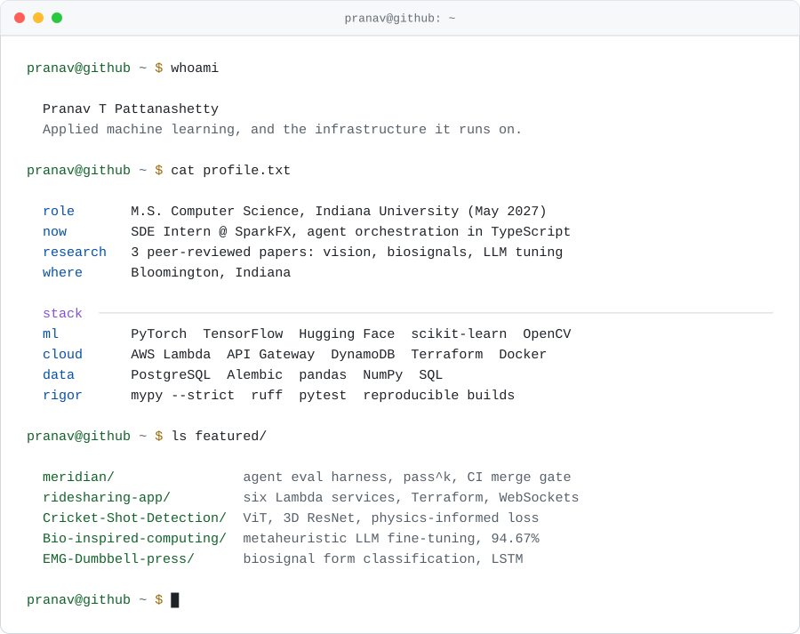

<picture>
  <source media="(prefers-color-scheme: dark)" srcset="assets/terminal-dark.svg">
  <source media="(prefers-color-scheme: light)" srcset="assets/terminal-light.svg">
  
</picture>

## Featured work

**[meridian](https://github.com/patsypppe/meridian)** · agent evaluation harness

Answers one question: did this change make the agent better or worse, and can you reproduce that answer
tomorrow. Every trial runs in its own container with its own workdir volume, and the suite ships a
contamination probe with a deliberate failing direction so isolation is asserted rather than assumed.
Scoring uses `pass^k` rather than a single accuracy number. A PR gate compares head against the merge
base and blocks only when the drop clears both a tolerance and a significance test.

`Python 3.12` `Typer` `Docker` `Postgres + Alembic` `Starlette` — `mypy --strict` and `ruff` enforced in
CI, 226 unit tests green in under three seconds.

**[ridesharing-app](https://github.com/patsypppe/ridesharing-app)** · serverless AWS backend

Six Lambda-backed services behind an HTTP API Gateway, a separate WebSocket API for live location,
DynamoDB for state, Cognito for auth, and the environment declared in Terraform rather than clicked
together in a console. Written as an infrastructure study, and the README says plainly which pieces are
built and which are not.

`Node.js` `Terraform` `Lambda` `DynamoDB` `API Gateway v2` `Cognito` `EventBridge`

**[Cricket-Shot-Detection](https://github.com/patsypppe/Cricket-Shot-Detection)** · video classification with physics constraints

Five model variants over the same seven-class problem, written to be compared: a CNN-GRU with key-frame
selection, a MobileNet baseline, a 3D ResNet with Vision Transformer, and a physics-informed model that
adds temporal continuity, energy, and momentum terms to the classification loss. A bat swing is a smooth
trajectory, so a model whose per-frame beliefs jump around is wrong even when its final answer is right.

`PyTorch` `ViT` `3D ResNet` `Grad-CAM` `Weights & Biases`

**[Bio-inspired-computing](https://github.com/patsypppe/Bio-inspired-computing)** · fine-tuning by evolutionary search

How much of a pre-trained model should you freeze? Usually a guess. This searches for the answer instead:
a genetic algorithm and the Whale Optimization Algorithm over freezing percentage and crossover operator
for RoBERTa on SST-2. Two findings held across every configuration: SBX crossover wins, and less freezing
wins. Best result 94.67% accuracy.

`PyTorch` `Hugging Face` `RoBERTa` `genetic algorithms` `SST-2`

**[EMG-Dumbbell-press](https://github.com/patsypppe/EMG-Dumbbell-press)** · exercise form from surface EMG

A signal problem before it is a modelling problem. Neither the deltoid nor the pectoral channel says much
alone, so the pipeline computes windowed RMS, integrated area, skewness and kurtosis per channel and
classifies the balance between them. Best validation accuracy in the committed notebooks is 92.5%, on a
small (~80 sample) split, which the README states alongside the figure.

`TensorFlow/Keras` `LSTM` `SciPy` `pandas`

## Research

Three peer-reviewed conference papers, in computer vision, biosignal processing, and LLM optimization.
Each has a public repository above. Citations and DOIs are on
[LinkedIn](https://www.linkedin.com/in/pranavpattanashetty), or email me for the PDFs.

## Currently

Building [meridian](https://github.com/patsypppe/meridian) toward a release a team other than mine could
adopt. At SparkFX, agent-based issue triage in a Next.js and TypeScript codebase.

Graduating May 2027, open to new-grad software, machine learning, and cloud engineering roles in the US.

## Contact

[ppattana@iu.edu](mailto:ppattana@iu.edu) · [LinkedIn](https://www.linkedin.com/in/pranavpattanashetty) · Bloomington, Indiana

The panel above is a static SVG generated by <a href="assets/gen.py"><code>assets/gen.py</code></a>.
No stats service, no API token, no scheduled job, nothing that can decay into "no activity tracked".
Regenerate with <code>python3 assets/gen.py</code>.
